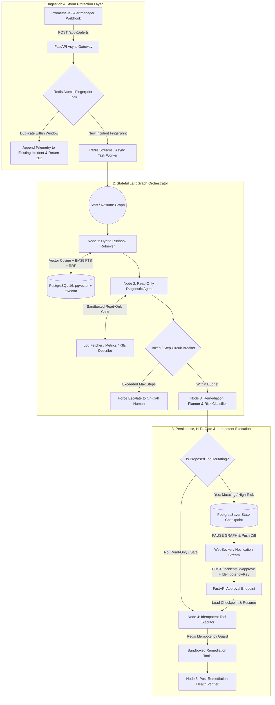

# Stateful Incident Triage & Runbook Agent
### System Architecture & Engineering Decision Record (EDR)

---

## 1. Executive Summary & Problem Context

### Production Failure Modes of Naive LLM Agents in Infrastructure Engineering
Deploying standard LLM agents to production Site Reliability Engineering (SRE) workflows presents critical reliability and security challenges:

1. **Unbounded Cost & Alert Storm Cascades:** When a database or core service degrades, Prometheus or Datadog often fires hundreds of alerts within seconds. A naive webhook-to-agent service will spawn hundreds of parallel LLM loops, rapidly consuming token budgets and triggering provider rate limits.
2. **Dense Vector RAG Blindness:** Standard semantic embeddings (`text-embedding-3-small`, etc.) map text into dense conceptual space. While effective for thematic similarity, they frequently miss exact alphanumeric identifiers, exit codes (`ExitCode 137`), PostgreSQL states (`53300`), or Kubernetes error conditions (`CrashLoopBackOff`).
3. **Volatile State & Destructive Race Conditions:** In-memory agent execution (`while not done:`) cannot survive process crashes or long-lived pauses while waiting for an on-call engineer to review a destructive action (`kubectl rollout restart` or cache flushes). Furthermore, network retries can cause destructive commands to execute multiple times.
4. **Lack of Deterministic Evaluation:** Without structured offline benchmarking, it is impossible to quantitatively verify retrieval accuracy or guarantee that safety guardrails cannot be bypassed.

### System Solution
The **Stateful Incident Triage Agent** is an event-driven, fault-tolerant backend system built with **Python (FastAPI), Redis, PostgreSQL (`pgvector` + `tsvector`), and LangGraph**. It ingests alerts from monitoring systems, deduplicates storm spikes in sub-millisecond time, retrieves operational runbooks via **Hybrid Reciprocal Rank Fusion (RRF)**, autonomously runs **read-only** diagnostic tools, and uses **PostgreSQL-backed state checkpointing** to pause execution for **idempotent Human-in-the-Loop (HITL) approval** over WebSockets and REST before executing any state-mutating remediation.

---

## 2. High-Level System Architecture



---

## 3. Component Deep Dive: What, Why, and Trade-Offs

### Component 1: API & Ingestion Gateway (`FastAPI` + `Pydantic v2` + `Uvicorn`)

* **What It Does:**
  * Exposes asynchronous REST endpoints (`POST /api/v1/incidents/webhook`, `POST /api/v1/incidents/{id}/approve`, `GET /api/v1/incidents/{id}/status`) and a real-time WebSocket endpoint (`WS /api/v1/incidents/{id}/stream`).
  * Validates incoming alert payloads strictly using Pydantic schemas and acknowledges receipt immediately (`HTTP 200/202`) after passing the Redis deduplication gate, preventing upstream webhook timeouts.
* **Purpose & Utility:**
  * Decouples rapid HTTP webhook ingestion (<5ms response time) from multi-step diagnostic reasoning and tool execution (3?15 seconds).
* **Why FastAPI?**
  * Native `asyncio` support allows a single Uvicorn worker to maintain active WebSocket connections and concurrent non-blocking database/LLM I/O calls without thread-pool exhaustion.
  * Pydantic v2 core provides high-throughput JSON schema validation and integrates directly with structured output parsing.
* **Why NOT Other Frameworks?**
  * **Why not Django / Django REST Framework (DRF)?** Django's ORM and middleware stack are synchronous-first. Adding WebSockets, async database connection pools, and async graph streaming introduces unnecessary boilerplate and thread-safety overhead for an event-driven microservice.
  * **Why Python over Go for this service?** Python is the primary ecosystem for LLM orchestration (`langgraph`, vector math libraries, embedding interfaces, and async database drivers like `asyncpg`).
  * **Why not Flask?** Flask is WSGI (synchronous). Managing long-lived WebSocket connections alongside async I/O calls in Flask requires gevent/eventlet patching, which introduces operational fragility.

---

### Component 2: Alert Storm Deduplicator & Budget Guard (`Redis`)

* **What It Does:**
  * Computes a deterministic SHA-256 fingerprint for every incoming alert based on normalized attributes: `hash(service_name + cluster + alert_name + error_code)`, stripping volatile fields like timestamps, pod UUIDs, or ephemeral IPs.
  * Executes an atomic Redis operation (`SET key val NX EX`) across a configurable sliding cooldown window (e.g., 60 seconds):
    * **If New:** Generates an `incident_id`, establishes the lock key with TTL, and begins triage workflow.
    * **If Duplicate:** Increments `suppressed_alert_count` and returns immediately without consuming tokens or spawning redundant workflows.
* **Purpose & Utility:**
  * Protects downstream resources during cascading outages and prevents agent execution loops from compounding system load.
* **Why Redis?**
  * Sub-millisecond $O(1)$ atomic operations across distributed API workers.
* **Why NOT Other Approaches?**
  * **Why not deduplicate in PostgreSQL using `INSERT ... ON CONFLICT`?** During an alert storm (e.g., 1,000+ webhooks/second from failing microservices), hitting PostgreSQL for every raw payload exhausts connection pools and causes MVCC table bloat on high-frequency counter updates. Redis absorbs the burst in-memory.
  * **Why not Process-Local In-Memory Caches (`lru_cache` / `dict`)?** Across multiple worker processes or container replicas behind a load balancer, memory is not shared. Two concurrent alerts for the same outage hitting different containers would spawn conflicting agent workflows.

---

### Component 3: Hybrid Runbook Retrieval Engine (`PostgreSQL 16` + `pgvector` + `tsvector` + `RRF`)

* **What It Does:**
  * Stores operational runbooks chunked with structured metadata (`service`, `severity`, `symptoms`, `error_codes`).
  * Executes a parallel search combining dense and sparse indices:
    1. **Dense Semantic Search (`pgvector` HNSW index):** Cosine distance (`<=>`) on text embeddings captures conceptual similarity (e.g. "containers terminating under memory pressure" matches "Pod OOMKilled Troubleshooting").
    2. **Sparse Lexical Search (`tsvector` + `GIN` index):** Full-text search matches exact error codes and identifiers (e.g., `ExitCode 137`, `SQLSTATE 53300`, `CrashLoopBackOff`).
  * Combines both ranked lists using **Reciprocal Rank Fusion (RRF)**:
    $$RRF(d) = \sum_{m \in M} \frac{1}{k + r_m(d)}$$
    *(where $k = 60$ is the standard smoothing constant preventing extreme ranks from dominating).*
* **Purpose & Utility:**
  * Eliminates the standard failure mode of pure vector search in technical domains: missing exact alphanumeric error codes or CLI flags because they carry low semantic weight in generic embeddings.
* **Why PostgreSQL (`pgvector` + `tsvector`)?**
  * Unifies relational incident state, checkpoints, vector embeddings, and text indices in a single ACID-compliant transactional database.
  * `pgvector` with HNSW indices delivers single-digit millisecond latency on technical documentation corpuses.
* **Why NOT Dedicated Vector DBs (Pinecone, Milvus, Qdrant)?**
  * **Dual-Write Consistency:** Running a separate vector database alongside PostgreSQL introduces distributed consistency risks whenever runbooks are created, updated, or purged.
  * **Operational Overhead:** For corpus sizes under several million documents, running external vector infrastructure introduces network hops and maintenance complexity without measurable latency benefit over indexed PostgreSQL.
  * **Why RRF instead of Linear Score Interpolation ($\\alpha \\cdot \\text{cosine} + (1-\\alpha) \\cdot \\text{BM25}$)?** Cosine similarity is bounded in $[0, 1]$, whereas BM25/`ts_rank` scores are unbounded $[0, \\infty)$ depending on document length and term density. Combining raw scores requires query-dependent normalization, whereas RRF operates purely on ordinal ranks ($1^{\\text{st}}, 2^{\\text{nd}}, 3^{\\text{rd}}$), making it robust and tuning-free.

---

### Component 4: Stateful Agent Orchestrator (`LangGraph` + `PostgresSaver`)

* **What It Does:**
  * Models incident triage as an explicit directed state machine (`StateGraph`):
    1. `ingest_alert`: Validates alert payload and initializes operational state.
    2. `retrieve_runbook`: Executes hybrid pgvector + tsvector RRF query.
    3. `execute_diagnostics`: Runs read-only diagnostic tools (log inspection, pod status, PromQL metrics).
    4. `evaluate_remediation`: Synthesizes root cause analysis and identifies candidate remediation steps.
    5. `human_approval`: **Interrupt Gate** pausing graph execution when mutating actions are required.
    6. `execute_remediation`: Executes approved actions via the idempotent runner.
    7. `finalize_incident`: Compiles resolution summary and closes incident.
* **Why LangGraph?**
  * Supports explicit cyclic workflows, state persistence between node transitions, and built-in human-in-the-loop interrupt points (`interrupt_before`).
* **Why NOT Open-Ended Frameworks (CrewAI, AutoGen)?**
  * Multi-agent conversational frameworks introduce high token consumption, latency overhead, and conversational drift. Production incident response requires deterministic state transitions, clear safety gates, and bounded tool permissions.
* **Why NOT Batch Orchestrators (Airflow, Celery)?**
  * Airflow is built for scheduled batch DAGs with coarse-grained task scheduling (seconds latency), whereas incident triage requires sub-second dynamic, cyclic state routing based on immediate tool telemetry.

---

### Component 5: Sandboxed Tooling & Deterministic Idempotency Keys

* **What It Does:**
  * Categorizes tools strictly into two isolated tiers:
    - **Diagnostic (Read-Only):** `fetch_service_logs`, `check_k8s_pod_status`, `query_prometheus_metrics`, `check_db_connection_pool`. Always safe to run autonomously.
    - **Remediation (Mutating):** `restart_pod_deployment`, `scale_service_replicas`, `flush_redis_cache_key`, `rollback_canary_deployment`. Always require operator approval.
  * Enforces an **Idempotent Tool Runner** on mutating operations:
    1. Computes canonical SHA-256 idempotency key: `hash(incident_id + tool_name + json_params)`.
    2. Acquires a 30-second Redis distributed lock (`SET lock_key token NX EX 30`).
    3. Caches execution receipts with a 24-hour TTL; subsequent requests return cached receipts with `"replayed": True`.
* **Purpose & Utility:**
  * Prevents double-execution of destructive operations during network retries or concurrent worker loops.

---

### Component 6: Real-Time Event Streaming & Approval Channel (`WebSockets` + `REST`)

* **What It Does:**
  * Streams state transitions (`[INGESTED] -> [RETRIEVED RUNBOOKS] -> [DIAGNOSTIC TRACE] -> [AWAITING APPROVAL]`) over WebSockets (`WS /api/v1/incidents/{id}/stream`).
  * Exposes a transactional approval endpoint (`POST /api/v1/incidents/{id}/approve`) accepting `{"decision": "APPROVED" | "REJECTED", "approver": "sre@company.com"}`.
* **Why WebSockets + REST?**
  * WebSockets provide efficient push notifications for live client monitoring without polling.
  * REST approval actions provide standard HTTP transactional semantics, status codes (`200 OK`, `409 Conflict`), and compatibility with Slack interactive webhooks and PagerDuty actions.

---

### Component 7: Deterministic Evaluation & Benchmark Harness (`evals/`)

* **What It Does:**
  * Standalone evaluation harness (`evals/benchmark.py`) evaluating 25 synthetic incident scenarios (`evals/dataset.json`) across 5 operational categories:
    1. Kubernetes `OOMKilled` (`ExitCode 137`) & memory exhaustion
    2. PostgreSQL connection pool saturation (`SQLSTATE 53300`)
    3. Redis cache eviction and latency degradation
    4. Canary deployment regression (`HTTP 502/504`)
    5. Downstream API rate-limiting cascades (`HTTP 429`)
  * Reports reproducible metrics:
    - **Retrieval Performance:** `Recall@1`, `Recall@3`, and `MRR` comparing Pure Vector, Pure Keyword, and Hybrid RRF.
    - **Safety Guardrail Compliance:** 100% enforcement of human approval gates on mutating operations.
    - **Alert Storm Deduplication:** Validates storm suppression and duplicate request coalescing.

---

## 4. End-to-End Request Lifecycle Walkthrough

```
[ Alert Ingestion ] (T+0ms)
       ?
       ?
[ Redis Fingerprint & Dedup ] (T+2ms)
  ??? Duplicate ??> Coalesce telemetry & return 200 OK
  ??? New Alert ??> Lock fingerprint, spawn incident thread
       ?
       ?
[ Hybrid RRF Retrieval ] (T+45ms)
  ??? Vector cosine search (semantic concepts)
  ??? TSVector full-text search (exact error codes)
  ??? Reciprocal Rank Fusion fuses candidate ranks
       ?
       ?
[ Sandboxed Diagnostics ] (T+1.8s)
  ??? Query pod status, Prometheus metrics, and error logs
  ??? Synthesize diagnostic evidence into root cause hypothesis
       ?
       ?
[ Remediation Risk Evaluation ] (T+3.2s)
  ??? Is proposed action mutating?
  ?     ??? No  ??> Auto-execute safe action
  ?     ??? Yes ??> Hit LangGraph interrupt_before gate
  ??? Persist checkpoint to PostgreSQL & stream notification to WebSocket
       ?
       ?
[ Operator Approval & Verification ] (T+45s)
  ??? On-call SRE reviews RCA and submits POST /approve
  ??? Reload checkpoint state and acquire Redis distributed lock
  ??? Execute mutating remediation and verify post-remediation health
  ??? Finalize incident and mark RESOLVED
```

---

## 5. Technical Decision Matrix

| Architectural Layer | Chosen Technology | Rejected Alternatives | Primary Engineering Justification |
| :--- | :--- | :--- | :--- |
| **API & Streaming** | **FastAPI (Async Python)** | Django DRF, Flask | Native `asyncio` for concurrent WebSockets, non-blocking DB/LLM I/O, and Rust-backed Pydantic schema validation. |
| **Storm Deduplication** | **Redis (`SET NX EX`)** | PostgreSQL upserts, In-memory Python cache | Absorbs webhook bursts in `<2ms` without exhausting DB connections; shared across stateless API replicas. |
| **Runbook Retrieval** | **PostgreSQL (`pgvector` + `tsvector` RRF)** | Pinecone / Qdrant, Pure Vector Search | Eliminates dual-write consistency issues between relational and vector DBs; RRF resolves vector blindness on exact hex/error codes. |
| **Agent Orchestration** | **LangGraph + Checkpointer** | LangChain `AgentExecutor`, CrewAI, AutoGen | Explicit state machine with checkpoint persistence, crash recovery, and deterministic `interrupt_before` HITL gates. |
| **Tool Safety** | **Split Registry + Redis Idempotency Keys** | Prompt-only safety ("Please ask before deleting") | Enforcing read/write separation and idempotency keys in code guarantees zero unauthorized or duplicate mutations. |
